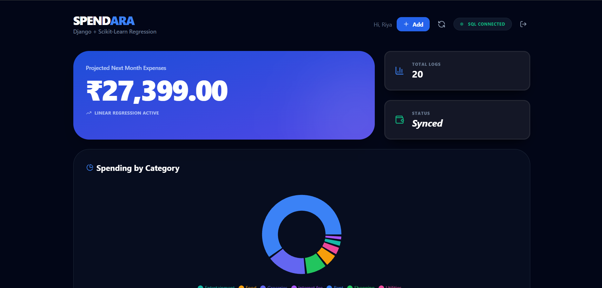
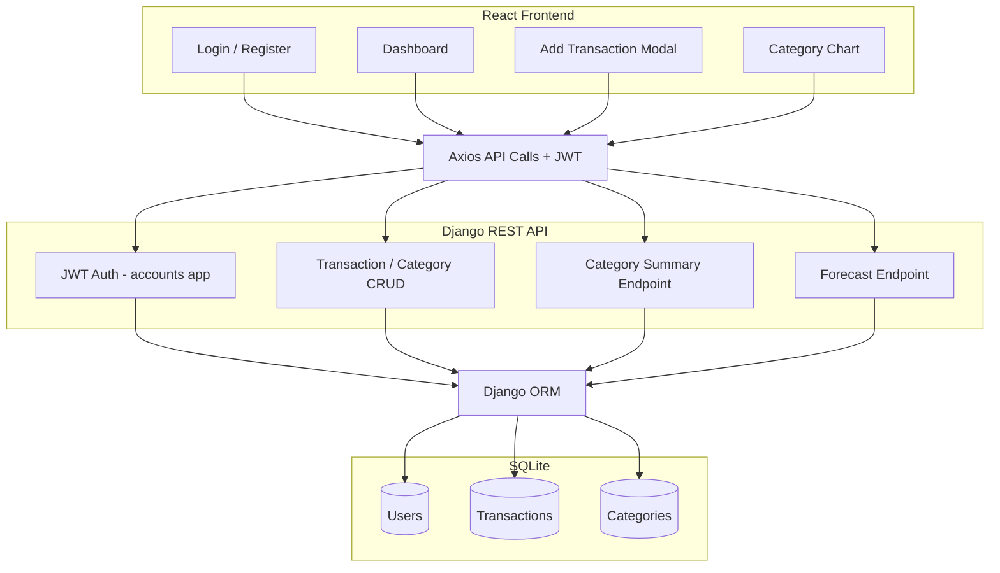
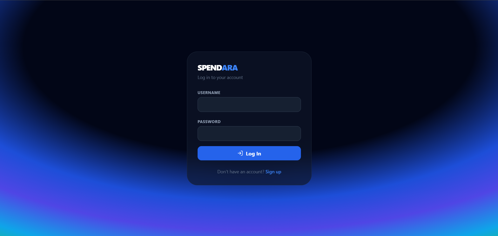
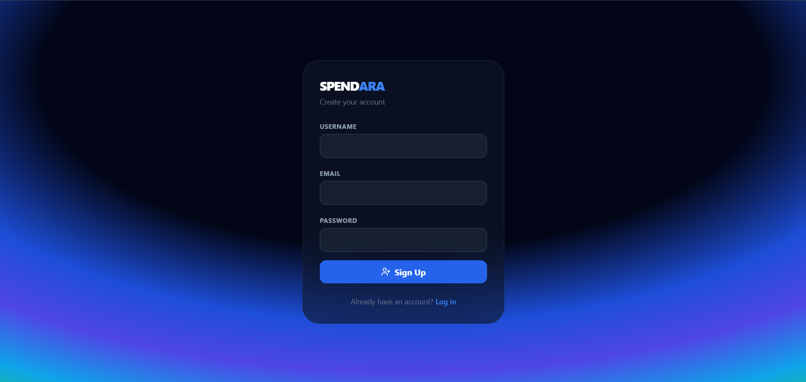
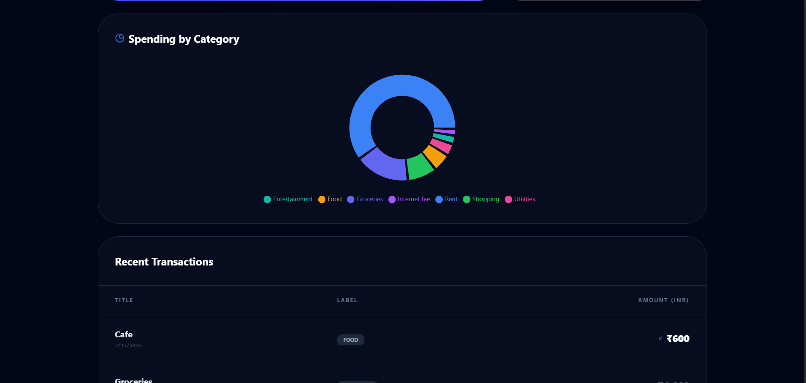
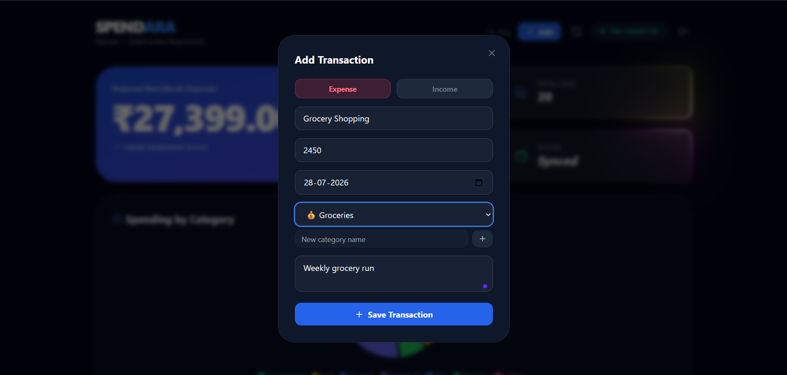

# 💰 Spendara

Full-stack personal finance tracker: Django REST Framework API with JWT auth, React frontend, and a scikit-learn model that forecasts next month's spending.

- Register and log in with JWT; each user sees only their own data
- Add income/expense transactions with custom categories
- Category-wise spending breakdown (pie chart)
- Next-month spending forecast from completed monthly totals (Linear Regression)


[](https://www.djangoproject.com/)
[](https://www.django-rest-framework.org/)
[](https://reactjs.org/)
[](https://scikit-learn.org/)

<div align="center">
  
</div>

---

## ✨ Features

- **🔐 JWT Authentication** – User registration and login; every API endpoint is scoped to the logged-in user. Category ownership is covered by automated tests.
- **📊 Expense Tracking** – Add income/expense transactions with custom categories
- **📈 Spending Insights** – Category-wise breakdown of expenses via an interactive pie chart
- **🤖 ML-Powered Forecasts** – Predicts next month's total spending using Linear Regression on completed monthly totals (excludes the current, still-in-progress month to avoid skewed trends)
- **🎨 Polished UI** – Animated gradient background, cursor-tracking spotlight cards, and a custom circular loading spinner
- **🔄 Auto-refresh** – The dashboard, chart, and forecast reload after each new transaction

---

## 🛠️ Tech Stack

### Backend
| Technology | Purpose |
| :--- | :--- |
| **Django** | Web framework |
| **Django REST Framework** | REST API development |
| **Simple JWT** | Authentication |
| **Scikit-Learn** | ML forecasting (Linear Regression) |
| **Pandas / NumPy** | Data aggregation & processing |
| **python-dotenv** | Loads secrets from a local `.env` file |
| **SQLite** | Local database (PostgreSQL planned for deployment) |

### Frontend
| Technology | Purpose |
| :--- | :--- |
| **React (Vite)** | UI framework |
| **React Router** | Client-side routing & protected routes |
| **Axios** | API calls with JWT interceptors (refreshes an expired token and retries) |
| **Recharts** | Spending-by-category pie chart |
| **Framer Motion** | Animations (gradients, transitions, glow cards) |
| **Tailwind CSS** | Styling |

---

## 🏗️ Architecture



---

## 🚀 Installation

### Prerequisites
- Python 3.12+
- Node.js 20.19+ (required by Vite 7)
- pip

### Backend Setup

```bash
# Clone the repository
git clone https://github.com/IshitaSajeev/Spendara.git
cd Spendara

# Create virtual environment
python -m venv venv
source venv/bin/activate  # On Windows: venv\Scripts\activate

# Install dependencies
pip install -r requirements.txt
```

Create a `.env` file in the project root (next to `manage.py`) with a secret key:

```
SECRET_KEY=your-generated-key-here
```

You can generate one with:

```bash
python -c "from django.core.management.utils import get_random_secret_key; print(get_random_secret_key())"
```

Then run the migrations and start the server:

```bash
# Run migrations
python manage.py migrate

# Run the server
python manage.py runserver
```
Backend runs at `http://127.0.0.1:8000/`

### Frontend Setup

```bash
cd spendara_frontend

# Install dependencies
npm install

# Start development server
npm run dev
```
Frontend runs at `http://127.0.0.1:5173/`

**First use:** register a new account on `/register`, then log in — all transactions are scoped to your logged-in user.

### Run the tests

```bash
python manage.py test transactions
```

---

## 📖 API Endpoints

| Method | Endpoint | Description |
| :--- | :--- | :--- |
| `POST` | `/api/auth/register/` | Create a new user account |
| `POST` | `/api/token/` | Log in, returns access + refresh JWT |
| `POST` | `/api/token/refresh/` | Refresh an expired access token |
| `GET` / `POST` | `/api/transactions/` | List or create transactions (user-scoped) |
| `GET` / `PUT` / `PATCH` / `DELETE` | `/api/transactions/<id>/` | Retrieve, update, or delete a transaction |
| `GET` / `POST` | `/api/categories/` | List or create categories (user-scoped) |
| `GET` | `/api/categories/summary/` | Expense totals grouped by category (chart data) |
| `GET` | `/api/forecast/` | Next month's predicted spending (Linear Regression) |

### Sample API Call

Register a user first (or use the account you created in the app), then:

```bash
# Login and get token
curl -X POST http://127.0.0.1:8000/api/token/ \
  -H "Content-Type: application/json" \
  -d '{"username": "demo", "password": "demo123"}'

# Get spending forecast
curl -X GET http://127.0.0.1:8000/api/forecast/ \
  -H "Authorization: Bearer <your_access_token>"
```

**Sample Response** (2 completed months, the minimum for a trend):
```json
{
  "predicted_spending_next_month": 27399.0,
  "data_points_used": 20,
  "months_used": 2,
  "current_month_to_date": 19600.0,
  "message": "AI prediction generated using Linear Regression on completed monthly totals.",
  "algorithm": "Linear Regression (completed monthly totals)"
}
```

`data_points_used` is the number of expense transactions; `months_used` is the number of completed months the model was trained on. With only 2 months, the "trend" is a straight line through two points, so the forecast becomes more meaningful with more history.

---

## 🤖 Machine Learning

The forecast model aggregates expenses into **calendar-month totals**, then fits a Linear Regression on `month_index → total_spent` to predict next month's total.

**Key design decision:** the current, still-in-progress month is excluded from training. Comparing a complete month against a partial one would make spending look artificially lower — not because you're spending less, but because the month simply isn't over yet.

**Edge cases, as implemented:**
- Fewer than 2 completed months: the model is not trained. With 1 completed month it returns that month's total; with none it returns the current month-to-date; with no expenses at all it returns 0.
- If the fitted trend predicts a non-positive value, the average of the completed months is returned instead.

**Limitation:** months with no expenses are skipped, so `month_index` counts months that have data rather than real calendar gaps.

---

## 📸 Screenshots

| Login | Register |
|---|---|
|  |  |

| Spending Breakdown | Add Transaction |
|---|---|
|  |  |

---

## ⚠️ Known Limitations

- The UI can add transactions but not edit or delete them (the API supports `PUT`, `PATCH`, and `DELETE`).
- The frontend API URL is hardcoded to `http://127.0.0.1:8000`, so it needs an environment variable before deployment.
- Tests currently cover category ownership only.
- SQLite only; PostgreSQL is planned.
- The forecast needs at least 2 completed months of expense history to use the regression.
- JWT tokens are stored in the browser's `localStorage`.

---

## 🌐 Deployment

Not yet deployed. Planned stack:
- **Frontend:** Vercel
- **Backend:** Render
- **Database:** Neon or Supabase (PostgreSQL)

---

## 📄 License

Distributed under the MIT License. See `LICENSE` for details.

---

## 👩‍💻 Author

**Ishita Sajeev**
[GitHub](https://github.com/IshitaSajeev) · [LinkedIn](https://linkedin.com/in/ishita-sajeev)